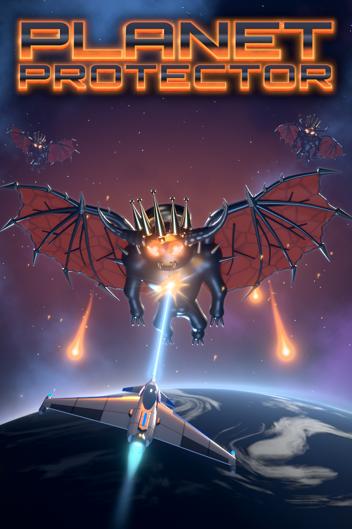
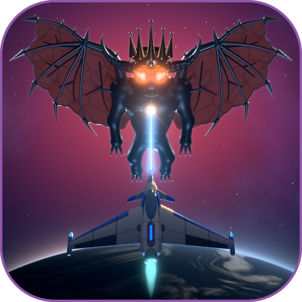
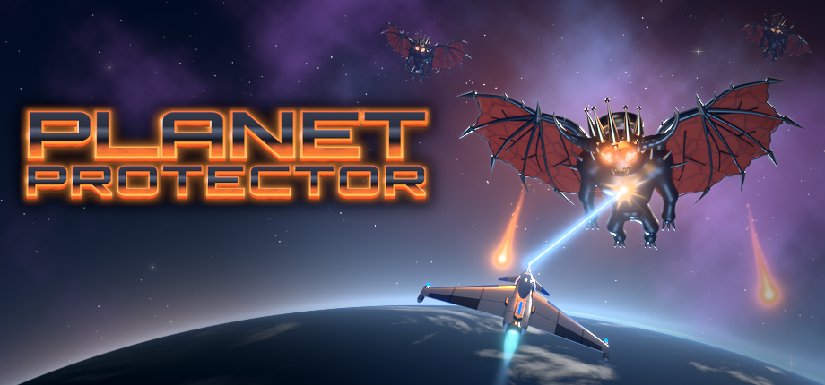
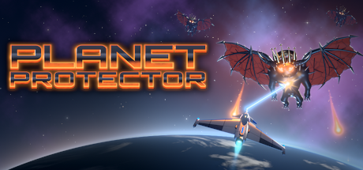
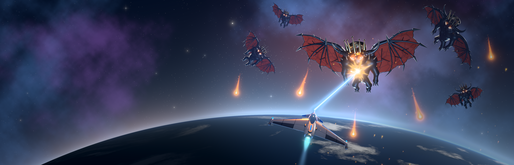
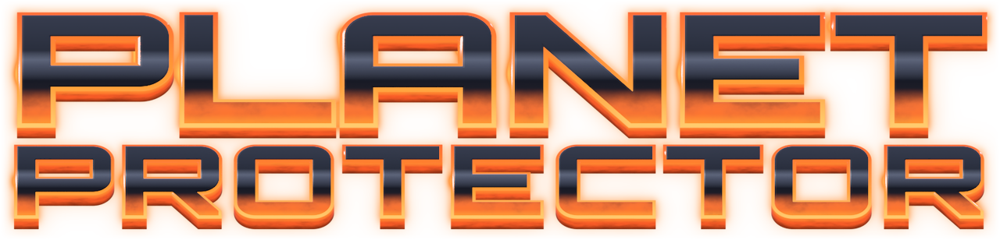

# Steam-Bilder für Planet Protector

Wer Planet Protector als **Nicht-Steam-Spiel** in Steam einträgt (siehe [Haupt-README, Abschnitt „Steam Deck“](../README.md#steam-deck)),
sieht in der Bibliothek erst einmal nur eine graue Kachel. Mit diesen Bildern sieht das Spiel dort aus wie jedes andere –
auf dem PC und auf dem Steam Deck.

## Die Dateien

| Datei | Wofür (Steam-Bezeichnung) | Größe |
|---|---|---|
| [`capsule_600x900.png`](capsule_600x900.png) | Hochformat-Kachel im Bibliotheksraster (**Library Capsule**) | 600 × 900 |
| [`capsule_wide_920x430.png`](capsule_wide_920x430.png) | breite Kachel, z. B. bei „zuletzt gespielt“ (**Wide Capsule / Grid**) | 920 × 430 |
| [`header_460x215.png`](header_460x215.png) | dasselbe Motiv klein, für Ansichten und Werkzeuge, die das alte Format erwarten (**Header**) | 460 × 215 |
| [`hero_3840x1240.png`](hero_3840x1240.png) | großes Banner oben auf der Spielseite, bewusst ohne Schrift – Steam legt das Logo darüber (**Library Hero**) | 3840 × 1240 |
| [`logo.png`](logo.png) | das Spiel-Logo, transparenter Hintergrund (**Library Logo**) | 1280 × 308 |
| [`icon_512.png`](icon_512.png) | Symbol, z. B. in der Bibliotheksliste – im Rahmen des Spiel-Icons, Ecken transparent (**Icon**) | 512 × 512 |

<p>
  
  &nbsp;
  
</p>









## Bilder in Steam einstellen

### Im Steam-Client (PC oder Steam Deck im Desktop-Modus)

1. **Kachel:** In der Bibliothek mit der rechten Maustaste auf Planet Protector klicken → „Manage“ → „Set custom artwork“
   → `capsule_600x900.png` wählen.
2. **Banner:** Die Spielseite öffnen, mit der rechten Maustaste auf das große Bild oben klicken → „Set custom background“
   → `hero_3840x1240.png`.
3. **Logo:** Ebenfalls per Rechtsklick auf das Banner → „Set custom logo“ → `logo.png`. Im selben Menü lässt sich auch
   die Position des Logos anpassen.
4. **Icon:** Rechtsklick auf das Spiel → „Properties …“ → auf das Symbolfeld neben dem Namen klicken → `icon_512.png`.

Die Menüpunkte stehen hier auf Englisch; im deutschen Steam heißen sie entsprechend übersetzt, und der genaue Wortlaut
kann je nach Sprache und Steam-Version etwas abweichen.

**Tipp für die breite Kachel:** Steam legt eigene Bilder im Ordner `userdata/<Kontonummer>/config/grid/` des
Steam-Verzeichnisses ab (unter Linux und auf dem Deck meist `~/.steam/steam/userdata/…`, unter Windows
`C:\Program Files (x86)\Steam\userdata\…`). Nach Schritt 1 liegt dort eine Datei wie `1234567890p.png` – die Zahl ist
die Nummer der Verknüpfung. Eine Kopie von `capsule_wide_920x430.png` als `1234567890.png` (ohne „p“) in denselben
Ordner legen und Steam neu starten.

### Mit Werkzeugen

- **Steam ROM Manager** (Linux und Windows, auf dem Deck im Desktop-Modus) kann für Nicht-Steam-Spiele alle Bildarten
  – Kachel, breite Kachel, Banner, Logo und Icon – auch aus lokalen Dateien setzen.
- Das **SteamGridDB-Plugin für Decky Loader** ändert die Bilder direkt im Spielmodus des Steam Deck; je nach Version
  lassen sich dort ebenfalls lokale Dateien auswählen.

## So sind die Bilder entstanden

Alles ist mit Blender (Cycles) aus den Original-Modellen des Spiels gerendert: der Interceptor, der gekrönte schwarze
Erd-Dämon aus den letzten Leveln und die Erde mit den Texturen aus dem Spiel. Weltraum, Laser, Feuerbälle und Leuchten
kommen in einem 2-D-Schritt dazu, das Logo ist das Logo aus dem Spiel.

Neu erzeugen (Blender als Python-Modul `bpy` über `BPY_PYTHON`, dazu `python3` mit numpy, scipy und Pillow):

```bash
python3 tools/blender/steam_keyart.py                  # alles neu, schreibt nach steam-grid/ (ca. 30 Minuten)
python3 tools/blender/steam_keyart.py --compose-only   # nur der 2-D-Schritt aus den vorhandenen Renderings
python3 tools/blender/steam_keyart.py --help           # alle Optionen
```
